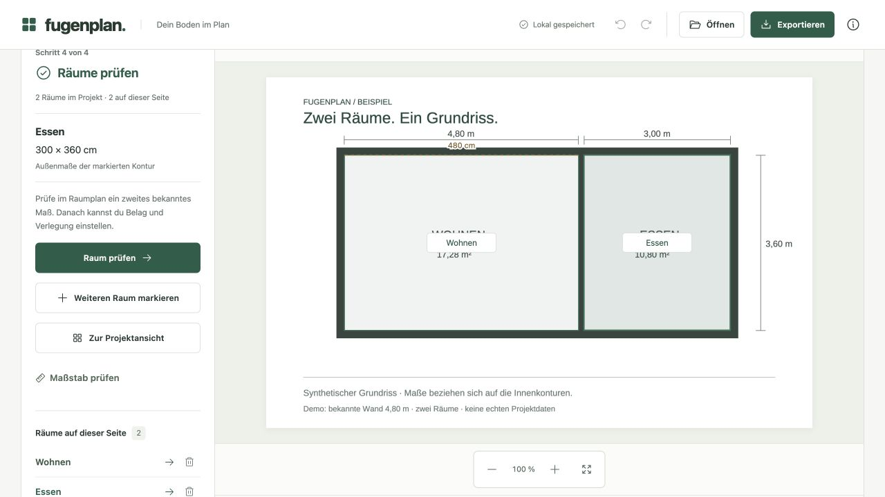
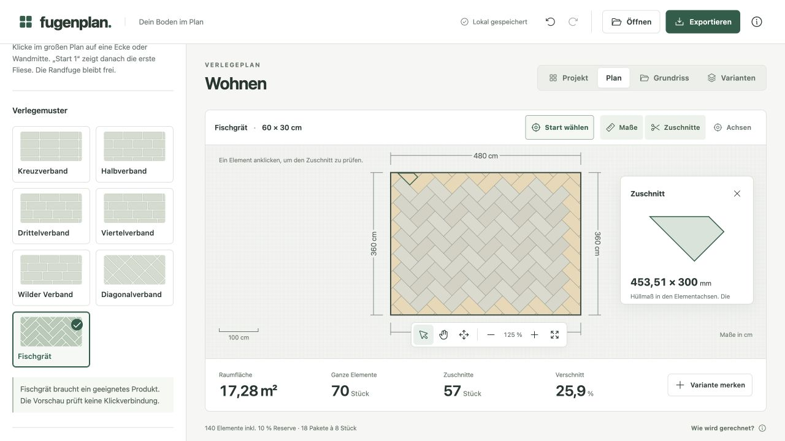
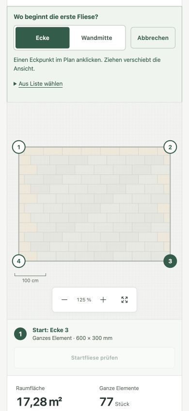

<div align="center">


# Fugenplan

**Dein Boden im Plan.**

Fliesen und Dielen planen, Zuschnitte prüfen, Materialbedarf berechnen.<br>
Vom PDF-Grundriss zum Verlegeplan – direkt in deinem Browser.

[**Jetzt im Browser ausprobieren**](https://fugenplan.netlify.app) · [Anleitung lesen](docs/ANLEITUNG.md)

<p>
  <a href="https://fugenplan.netlify.app"></a>
  <a href="#daten-unter-deiner-kontrolle"></a>
  <a href="#grundriss-und-gebäude"></a>
  <a href="#belag-und-zuschnitte"></a>
  <a href="#varianten-und-exporte"></a>
</p>

<a href="screenshots/demo-pdf.gif">
  <picture>
    <source media="(prefers-reduced-motion: reduce)" srcset="screenshots/demo-pdf-poster.jpg">
    
  </picture>
</a>

*Grundriss laden → Maßstab setzen → Räume markieren → Verlegung prüfen.*

<sub>Demo mit einem synthetischen Beispielgrundriss. <a href="screenshots/demo-pdf-poster.jpg">Standbild ansehen</a></sub>

[Warum Fugenplan?](#warum-fugenplan) · [Funktionen](#funktionen) · [Bilder](#einblicke-in-die-planung) · [Schnellstart](#schnellstart) · [FAQ](#faq) · [Entwicklung](#entwicklung)

</div>

## Warum Fugenplan?

Eine schmale Fliese an der Tür fällt im Plan auf, bevor du sie schneidest. Mit Fugenplan prüfst du die Aufteilung für deine Räume. Ändere Format, Muster oder Startpunkt und sieh, wie sich Zuschnitte und Materialbedarf verändern.

- **Randstücke früh erkennen.** Zuschnitte hervorheben und einzelne Schnittkonturen mit ihren Maßen prüfen.
- **Aufteilungen vergleichen.** Verschiedene Einstellungen als Varianten merken und später wieder öffnen.
- **Das Gebäude im Blick behalten.** Projekte, Etagen und Räume verwalten. Die Etagenansicht zeigt die Verlegepläne gemeinsam an ihren Positionen im Grundriss.
- **Ohne Konto planen.** Berechnung und PDF-Verarbeitung laufen auf deinem Gerät. Wichtige Stände sicherst du als Projektdatei.

## Funktionen

### Grundriss und Gebäude

| Bereich | Das kannst du damit planen |
| --- | --- |
| PDF-Grundriss | Eine bekannte Wandlänge legt den Maßstab fest. Markiere die inneren Raumecken und übernimm die Räume in deinen Plan. |
| Raumkontur | Rechtecke, L-Formen und freie Konturen mit eigenen Maßen. Rechteckige Hindernisse wie Säulen bleiben frei. |
| Etagenansicht | Räume mit ihren Verlegeplänen gemeinsam ansehen. Jede Etage hat einen eigenen Grundriss und Maßstab. Manuelle Räume lassen sich nachträglich anordnen. |

### Belag und Zuschnitte

| Bereich | Das kannst du damit prüfen |
| --- | --- |
| Produkt und Muster | Eigene Produktmaße, Fugenbreite und Randabstand einstellen. Muster wählen, drehen und verschieben. |
| Startposition | Eine Ecke oder Wandmitte direkt im Plan wählen. Die Startfliese bleibt markiert. |
| Schnittkonturen | Zuschnitte hervorheben. Einzelne Elemente mit Kantenlängen und Hüllmaßen ansehen. |
| Materialbedarf | Ganze Elemente, Zuschnitte und Verschnitt sehen. Reserve ergänzen und Pakete aufrunden. |

**Sieben Verlegemuster:** Kreuzverband · Halbverband · Drittelverband · Viertelverband · Wilder Verband · Diagonalverband · Fischgrät.

### Varianten und Exporte

| Bereich | Das kannst du damit sichern oder weitergeben |
| --- | --- |
| Varianten | Bis zu zwölf Aufteilungen merken. Änderungen rückgängig machen und wiederholen. |
| Projektdatei | Alle Etagen, Räume, Einstellungen, Maßstäbe und Original-PDFs zusammen sichern und später wieder öffnen. |
| SVG | Den aktiven Raum als Vektorgrafik in einem gewählten Maßstab exportieren. |
| Druck / PDF | Einen A4-Bericht zum aktiven Raum über den Browser-Druckdialog drucken oder als PDF speichern. |
| CSV | Die Elementliste des aktiven Raums mit Hüllmaßen, Flächen und Schnittkonturen in einer Tabelle öffnen. |

Separat gemerkte Varianten bleiben im Browser. Sie sind nicht Teil der Projektdatei.

## Einblicke in die Planung

Die Bilder zeigen den Weg vom Grundriss bis zur Schnittkontur. Ein Klick öffnet das jeweilige Bild in voller Größe.

<table>
  <tr>
    <td width="50%" valign="top">
      <a href="screenshots/readme/grundriss-assistent.jpg"></a><br>
      <sub><b>Grundriss übernehmen.</b> Maßstab setzen, Räume markieren und prüfen.</sub>
    </td>
    <td width="50%" valign="top">
      <a href="screenshots/hierarchy/etagenprojekt-desktop.jpg"></a><br>
      <sub><b>Räume gemeinsam ansehen.</b> Verlegepläne im Zusammenhang der Etage prüfen.</sub>
    </td>
  </tr>
  <tr>
    <td width="50%" valign="top">
      <a href="screenshots/readme/startwahl-desktop.jpg"></a><br>
      <sub><b>Den Anfang festlegen.</b> Startposition direkt an einer Ecke oder Wandmitte wählen.</sub>
    </td>
    <td width="50%" valign="top">
      <a href="screenshots/readme/muster-zuschnitte.jpg"></a><br>
      <sub><b>Zuschnitte verstehen.</b> Muster vergleichen und einzelne Schnittkonturen ansehen.</sub>
    </td>
  </tr>
</table>

<details>
<summary><strong>Auch auf dem Smartphone: Startposition im Plan wählen</strong></summary>

<p align="center">
  <a href="screenshots/readme/startwahl-mobil.jpg"></a>
</p>

Die Oberfläche passt sich an die Bildschirmbreite an. Für große Grundrisse bietet ein Desktop mehr Platz.

</details>

Alle gezeigten Räume und mitgelieferten Prüf-PDFs sind synthetische Beispiele.

## Schnellstart

Öffne **[Fugenplan im Browser](https://fugenplan.netlify.app)**. Du brauchst kein Konto und keine Installation.

1. **Projekt anlegen.** Lege eine Etage an, zum Beispiel das Erdgeschoss.
2. **Räume erfassen.** Lade einen PDF-Grundriss und markiere die Räume. Alternativ gibst du die Raummaße selbst ein.
3. **Verlegung einstellen.** Wähle Produktmaße, Muster und Startposition. Prüfe die Randstücke und den Materialbedarf.
4. **Plan sichern.** Exportiere das Projekt als Datei. Für den aktiven Raum stehen zusätzlich SVG, CSV und Druck / PDF bereit.

Beim PDF-Import führt dich der Assistent durch Seite, Maßstab, Raumkontur und Prüfung. Gib die bekannte Wandlänge in Zentimetern ein: `480` für 4,80 m. Prüfe nach der Übernahme ein zweites bekanntes Maß.

Weiterlesen: [PDF-Grundriss übernehmen](docs/ANLEITUNG.md#räume-aus-einer-pdf-übernehmen) · [Einen Boden planen](docs/ANLEITUNG.md#einen-boden-planen) · [Auf deinem Rechner starten](#lokal-starten).

## Daten unter deiner Kontrolle

Geometrie und PDF-Verarbeitung laufen im Browser. Die Anwendung sendet keine Projektdaten an Netlify und enthält keine Analyse- oder Werbedienste. Der Hoster erhält die üblichen Anfragen zum Laden der Website.

Räume und Varianten liegen im Browserspeicher. Original-PDFs liegen in IndexedDB. Du kannst die Anwendung auch [lokal betreiben](#lokal-starten) oder [selbst hosten](#selbst-hosten).

> [!IMPORTANT]
> Der Speicher gehört zu diesem Browser und dieser Webadresse. Ein anderer Browser oder eine andere Adresse hat einen eigenen Speicher. Das Löschen von Browserdaten entfernt auch die dort gespeicherten Pläne. Sichere wichtige Projekte als Datei.

Für den Wechsel zwischen Geräten, Browsern oder Webadressen: Exportiere das Projekt am bisherigen Ort und öffne die Datei am neuen Ort. Eine automatische Synchronisierung gibt es nicht.

Eigene Grundrisse und Projektdateien gehören außerhalb des Quellcode-Repositorys. Siehe [Umgang mit privaten Daten](SECURITY.md).

## FAQ

<details>
<summary><strong>Welche PDF-Grundrisse kann ich verwenden?</strong></summary>

Vektor-PDFs und gescannte Vorlagen sind möglich. Eine PDF darf bis zu 200 Seiten und 20 MiB enthalten. Für die Anzeige darf ein einzelnes eingebettetes Rasterbild höchstens 64 Megapixel haben. Jede Etage verwendet eine Seite mit eigenem Maßstab. Mehrere Etagen können verschiedene Seiten oder Dateien verwenden.

Die Räume werden manuell markiert. Der Maßstab muss in beiden Richtungen gleich sein. Verzerrte Scans müssen vor dem Import korrigiert werden. Automatische Raumerkennung und Scan-Entzerrung sind nicht enthalten.

</details>

<details>
<summary><strong>Wie viele Projekte, Etagen und Räume kann ich anlegen?</strong></summary>

Die Sammlung unterstützt bis zu 20 Projekte, jeweils bis zu 50 Etagen und bis zu 50 Räume je Etage. Alle Eingabe- und Dateigrenzen stehen in der [Bedienungsanleitung](docs/ANLEITUNG.md#speicherung-und-grenzen).

</details>

<details>
<summary><strong>Wie werden Materialbedarf und Verschnitt berechnet?</strong></summary>

Jedes angeschnittene Element zählt als ein neues Ausgangsstück. Reststücke werden nicht automatisch für andere Stellen verwendet. Der Materialbedarf ist deshalb eine Berechnung ohne Reststückoptimierung.

Verschnitt ist die nicht verlegte Fläche der gezählten Ausgangsstücke, geteilt durch deren volle Fläche. Reserve wird zusätzlich auf die Stückzahl aufgeschlagen. Pakete werden aufgerundet.

Nur die markierte Startfliese kennzeichnet den gewählten Anfang. Die übrige Elementnummerierung ist keine vorgegebene Verlegereihenfolge.

</details>

<details>
<summary><strong>Was muss ich vor dem Verlegen und beim Drucken prüfen?</strong></summary>

Fugenplan ersetzt kein Aufmaß vor Ort. Prüfe Raummaße und Produktvorgaben für Fugen, Randabstände und Versatz. Fischgrät braucht ein geeignetes Produkt; Klickprofilregeln werden nicht geprüft. Der wilde Verband prüft keinen vom Hersteller geforderten Mindestabstand zwischen Kopfstößen.

Ein Hüllmaß umschließt die Schnittkontur. Bei schrägen Schnitten ist es keine Mindestbreite eines Reststücks. Prüfe deshalb die Kontur. „Zentrieren“ richtet das Raster mittig aus; es optimiert den Verschnitt nicht automatisch.

Für einen maßstäblichen Ausdruck: A4, 100 % und keine automatische Seitenanpassung wählen. Prüfe die 50-mm-Kontrollstrecke auf dem Ausdruck. Preise sowie Kleber- und Fugenmörtelverbrauch sind nicht enthalten.

Alle Rechenregeln stehen unter [Genauigkeit und Mengen](docs/ANLEITUNG.md#genauigkeit-und-mengen). Die [fachlichen Grundlagen](docs/RECHERCHE.md) nennen die verwendeten Quellen.

</details>

<details>
<summary><strong>Funktioniert Fugenplan ohne Internet?</strong></summary>

Die lokal installierte Anwendung arbeitet nach der ersten Paketinstallation auch ohne Internetverbindung. Schriften, Symbole und PDF-Decoder werden lokal bereitgestellt. Für den Start brauchst du den [lokalen Server](#lokal-starten).

</details>

## Dokumentation

| Du möchtest … | Hier geht es weiter |
| --- | --- |
| Die Anwendung bedienen | [Bedienungsanleitung](docs/ANLEITUNG.md) mit Tastatursteuerung und Eingabegrenzen |
| Die Berechnungen verstehen | [Fachliche Grundlagen](docs/RECHERCHE.md) und [PDF-Technik](docs/PDF-TECHNIK.md) |
| Die Prüfungen nachvollziehen | [Projektansicht und PDF-Assistent](docs/UX-ABNAHME.md), [Startwahl](docs/START-UX-PRUEFUNG.md), [PDF-Speicherung](docs/PDF-SPEICHER-PRUEFUNG.md) und [Fehlerkorrekturen](docs/REVIEW-FIXES-PRUEFUNG.md) |
| Die Anwendung bereitstellen | [Deployment und Betrieb](docs/DEPLOYMENT.md) |
| Mitwirken oder einen Fehler melden | [Hinweise zur Mitarbeit](CONTRIBUTING.md) und [Umgang mit privaten Daten](SECURITY.md) |

## Entwicklung

React · TypeScript · Vite · SVG · Web Worker · PDF.js

React bildet die Oberfläche ab. SVG zeigt die Pläne. Web Worker berechnen die Verlegung. PDF.js verarbeitet Grundrisse; Clipper und polygon-clipping berechnen Konturen. Die Anwendung braucht keine API-Schlüssel, keine `.env`-Datei und keine Datenbank.

### Lokal starten

[](.nvmrc)

Für den lokalen Start brauchst du Git und Node.js mit npm.

```sh
git clone https://github.com/dYn36/fugenplan.git
cd fugenplan
npm ci
npm start
```

Der Browser öffnet [Fugenplan auf deinem Rechner](http://127.0.0.1:5173). Lass das Terminal während der Nutzung geöffnet. Mit `Strg+C` beendest du den Server. Die erste Installation lädt Pakete aus npm.

Zum Klonen eines privaten Repositorys brauchst du Zugriff und eine GitHub-Anmeldung. Die Webanwendung ist davon unabhängig erreichbar. Hinweise zum Quellcode stehen unter [Projektstatus und Lizenz](#projektstatus-und-lizenz).

<details>
<summary><strong>Start unter macOS, Windows und Linux</strong></summary>

- macOS: Nach der Installation kannst du auch [`Starten.command`](Starten.command) doppelt anklicken.
- Windows und Linux: Nutze die Befehle oben im Terminal.
- Mit nvm: Führe vor `npm ci` einmal `nvm install` und `nvm use` aus. [`.nvmrc`](.nvmrc) wählt Node.js 24.
- Andere Node-Versionen: Die unterstützten Versionen stehen in [`package.json`](package.json).

</details>

<details>
<summary><strong>Tests, Befehle und Projektstruktur</strong></summary>

```sh
npm run dev          # Entwicklungsserver
npm test             # Geometrie, Speicherung, Kalibrierung und Exporte
npm run build        # TypeScript-Prüfung und Produktionsbuild
npm run preview      # Produktionsbuild lokal ansehen
npm run check        # Tests und Produktionsbuild zusammen
```

Für die kurze Browserprüfung wird Chromium benötigt:

```sh
npx playwright install --only-shell chromium
npm run test:e2e:smoke
```

Die automatische GitHub-Prüfung führt Fachtests, TypeScript, Build und acht wichtige Browserabläufe in Chromium aus. Dazu gehören PDF-Import, Maßstab, neue Etagen, PDF-Erhalt nach Browser-Neustart, Maßeingabe, Export und mobile Bedienung. Reine Dokumentations- und Screenshotänderungen starten keinen Lauf.

`npm run test:e2e` führt alle Chromium-Fälle aus. `npm run test:e2e:all` prüft nach Installation beider Browser zusätzlich WebKit. Diese vollständige Sammlung ist in GitHub nur manuell startbar. Für ein installiertes Microsoft Edge gibt es `npm run test:e2e:edge`. Die [PDF-Speicherprüfung](docs/PDF-SPEICHER-PRUEFUNG.md) beschreibt auch die Übernahme älterer Projekte. Testauswahl und Bedienung stehen in [CONTRIBUTING.md](CONTRIBUTING.md).

Unter Linux kann `npx playwright install --with-deps chromium` zusätzliche Systempakete installieren. Die Test-PDF lässt sich mit `node tests/fixtures/create-floorplan-fixture.mjs` neu erzeugen.

```text
src/components/  Oberfläche und Planansichten
src/lib/         Geometrie, PDF, Speicherung und Exporte
tests/           Automatische Tests und synthetische Prüfdaten
scripts/         Lokale PDF-Assets vorbereiten
docs/            Bedienung, Rechenregeln und Prüfnachweise
```

`npm ci` erzeugt `public/pdfjs/` aus der installierten PDF.js-Version. Dieser Ordner und `dist/` werden nicht eingecheckt. Die [GitHub-Prüfung](.github/workflows/checks.yml) führt Installation, Tests und Build mit Node.js 24 aus.

</details>

### Selbst hosten

Fugenplan besteht aus statischen Dateien. Ein Anwendungsserver und eine Datenbank sind nicht nötig.

```sh
npm ci
npm run build
```

Stelle den Ordner `dist/` über einen statischen Webhost bereit. Für die PDF-Verarbeitung braucht die Anwendung HTTPS oder localhost. Web Worker benötigen einen Webserver; öffne `index.html` nicht direkt als Datei.

Die [Netlify-Konfiguration](netlify.toml) verwendet Node.js 24, `npm run check` als Build-Befehl und `dist` als Ausgabeordner. Umgebungsvariablen sind nicht erforderlich. Sicherheitsheader und Cache-Regeln sind dort ebenfalls hinterlegt.

Git-Pushes veröffentlichen keine neue Produktionsversion. Prüfe Änderungen zuerst als Vorschau und veröffentliche danach den geprüften Build. Der Ablauf steht in [Deployment und Betrieb](docs/DEPLOYMENT.md).

## Projektstatus und Lizenz

Für den eigenen Quellcode ist noch keine Open-Source-Lizenz festgelegt. Hinweise zur Mitarbeit stehen in [CONTRIBUTING.md](CONTRIBUTING.md). Die [Prüfung vor öffentlicher Freigabe](docs/OEFFENTLICHE-FREIGABE.md) beschreibt den geprüften Stand und die verbleibende Lizenzentscheidung.

`private: true` verhindert eine versehentliche Veröffentlichung des npm-Pakets. Es steuert nicht die Sichtbarkeit des GitHub-Repositorys. Abhängigkeiten behalten ihre jeweiligen Lizenzen; siehe [Drittanbieter](THIRD_PARTY_NOTICES.md).

---

<div align="center">

**Dein nächster Boden beginnt im Plan.**<br>
[Jetzt Fugenplan ausprobieren](https://fugenplan.netlify.app) · [Anleitung öffnen](docs/ANLEITUNG.md)

</div>
