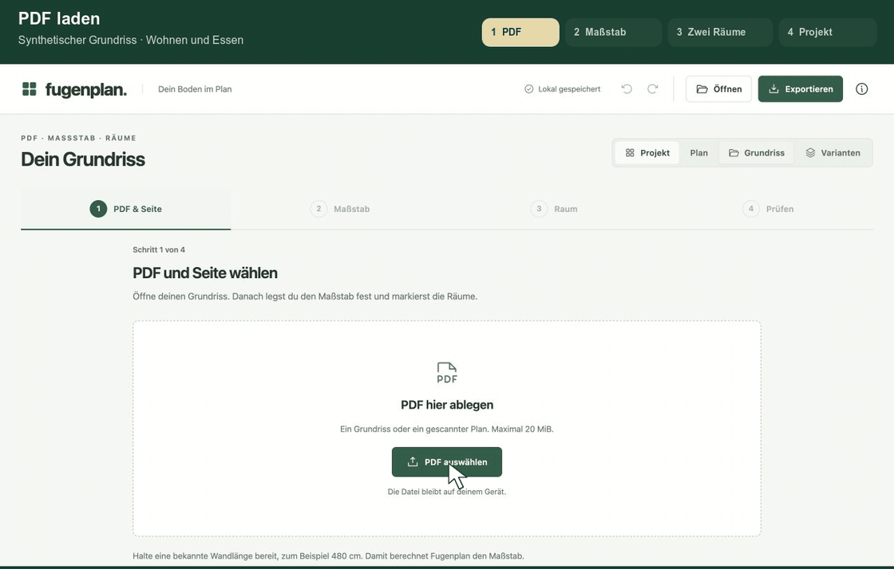
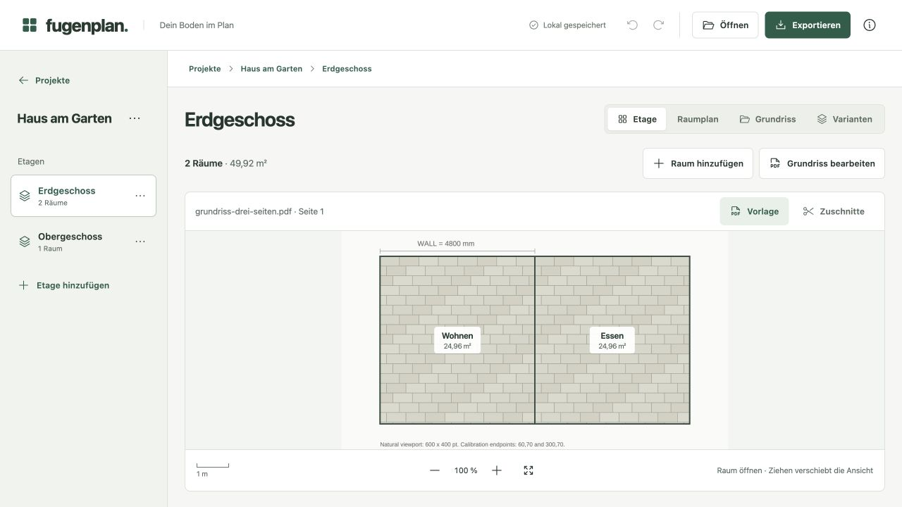
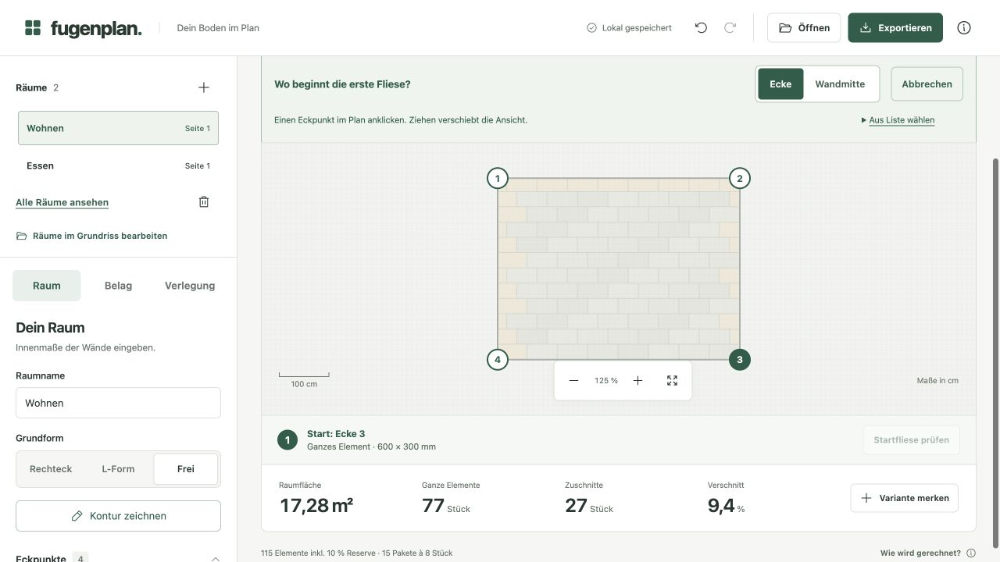

<div align="center">


# Fugenplan

Verlegepläne für Fliesen und Dielen.

Lade deinen PDF-Grundriss, markiere die Räume und vergleiche die Verlegung.<br>Du siehst, welche Stücke an den Wänden übrig bleiben und wie viel Material du brauchst.

<a href="screenshots/demo-pdf.gif">
  <picture>
    <source media="(prefers-reduced-motion: reduce)" srcset="screenshots/demo-pdf-poster.jpg">
    
  </picture>
</a>

*PDF laden → Wandmaß setzen → Zwei Räume markieren → Beide Verlegepläne gemeinsam ansehen.*

Demo mit einem synthetischen Beispielgrundriss. [Standbild ansehen](screenshots/demo-pdf-poster.jpg)

<p>
  <a href="#daten-unter-deiner-kontrolle"></a>
  <a href="#vom-grundriss-zum-verlegeplan"></a>
  <a href="#selbst-hosten"></a>
</p>

[Im Browser ausprobieren](https://fugenplan.netlify.app) · [PDF-Anleitung](#vom-grundriss-zum-verlegeplan) · [Funktionen entdecken](#dein-boden-bevor-er-liegt) · [Anleitung lesen](docs/ANLEITUNG.md)

| Bis zu 20 Projekte | Bis zu 50 Etagen je Projekt | Bis zu 50 Räume je Etage |
| :---: | :---: | :---: |
| Getrennte Planungen | Eigene Grundrisse und Maßstäbe | Gemeinsam im Etagenplan |

Du brauchst kein Konto. Die Planung und die PDF-Verarbeitung laufen auf deinem Gerät.

</div>

---

## Dein Boden, bevor er liegt

Eine schmale Fliese an der Tür fällt im Plan auf, bevor du sie schneidest. Ändere das Format, verschiebe den Verband oder wähle einen anderen Startpunkt. Fugenplan berechnet die Zuschnitte und Mengen neu. Verschiedene Aufteilungen kannst du als Varianten speichern und später wieder öffnen.

| Funktion | Was du damit planen kannst |
| --- | --- |
| PDF-Grundriss | Eine bekannte Wandlänge legt den Maßstab fest. Markierte Räume erscheinen mit ihrem Verlegeplan an der richtigen Position. |
| Raumkontur | Rechteck, L-Form oder freie Kontur. Rechteckige Hindernisse wie Säulen bleiben frei. |
| Gebäudeübersicht | Gemeinsame Etagenzeichnung mit den tatsächlichen PDF-Positionen. Projekte, Etagen und Räume getrennt verwalten. |
| Verlegemuster | Sieben Verlegemuster mit eigenen Produktmaßen, Fugen, Randabständen und Drehung. |
| Startpunkt | Eine Ecke oder Wandmitte direkt im Plan wählen. Die Startfliese bleibt markiert. |
| Zuschnitte | Zuschnitte hervorheben. Einzelne Schnittkonturen, Kantenlängen und Hüllmaße prüfen. |
| Materialbedarf | Ganze Elemente, Zuschnitte und Verschnitt sehen. Reserve ergänzen und Pakete aufrunden. |
| Varianten | Bis zu zwölf Varianten merken. Änderungen rückgängig machen und wiederholen. |

## Schnell starten

Öffne [fugenplan.netlify.app](https://fugenplan.netlify.app). Lege ein Projekt und eine Etage an. Danach kannst du einen PDF-Grundriss laden oder die Raummaße eingeben.

Wenn du bereits lokal geplant hast, exportiere dein Projekt dort als Datei und öffne diese auf der Netlify-Seite. Beide Webadressen haben getrennte Browserspeicher.

Für den Betrieb auf deinem Rechner brauchst du Git und Node.js 24 mit npm:

```sh
git clone https://github.com/dYn36/fugenplan.git
cd fugenplan
npm ci
npm start
```

Der Browser öffnet [Fugenplan auf deinem Rechner](http://127.0.0.1:5173). Lass das Terminal während der Nutzung geöffnet. Mit `Strg+C` beendest du den Server.

Für einen manuell erfassten Raum: „Raum hinzufügen“ wählen, Maße eingeben, Belag und Startpunkt festlegen. Die Formatvorgaben enthalten auch 12 × 30 cm.

Solange das Repository privat ist, brauchst du zum Klonen Zugriff und eine GitHub-Anmeldung. Die Webanwendung ist davon unabhängig erreichbar. Hinweise zur Nutzung des Quellcodes stehen unter [Lizenz](#projektstatus-und-lizenz).

<details>
<summary><strong>macOS, Windows, Linux und weitere Hinweise zum Start</strong></summary>

- macOS: Nach der Installation kannst du auch [`Starten.command`](Starten.command) doppelt anklicken.
- Windows und Linux: Nutze die Befehle oben im Terminal.
- Mit nvm: Führe vor `npm ci` einmal `nvm install` und `nvm use` aus. [`.nvmrc`](.nvmrc) wählt Node.js 24.
- Andere Node-Versionen: Die unterstützten Versionen stehen in [`package.json`](package.json).

Die Anwendung braucht keine API-Schlüssel, keine `.env`-Datei und keine Datenbank. Die erste Installation lädt Pakete aus npm. Danach arbeitet die lokal installierte Anwendung auch ohne Internetverbindung. Schriften, Symbole und PDF-Decoder werden lokal bereitgestellt.

</details>

## Dein Gebäude im Zusammenhang

Lege mehrere Projekte mit eigenen Etagen und Räumen an. Du kannst zwischen Erdgeschoss, Obergeschoss und weiteren Etagen wechseln. Die Übersicht zeigt PDF-Räume dort, wo sie im Grundriss liegen, mit ihren jeweiligen Verlegeplänen.



Jede Etage hat einen eigenen Grundriss und Maßstab. Verwende verschiedene PDFs oder mehrere Seiten derselben Datei. Manuelle Räume bleiben bis zur Eingabe ihrer Position als „Noch nicht angeordnet“ erkennbar. Eine Projektdatei sichert alle Etagen und Original-PDFs zusammen. [Projekte und Etagen bedienen](docs/ANLEITUNG.md#projekte-etagen-und-räume)

## Vom Grundriss zum Verlegeplan

Der Assistent führt dich durch vier Schritte: PDF und Seite wählen, Maßstab festlegen, Raum markieren und Ergebnis prüfen.

<a href="screenshots/readme/grundriss-assistent.jpg">
  
</a>

1. Grundriss öffnen. PDF auswählen, zur gewünschten Seite wechseln und „Seite verwenden“ wählen.
2. Eine Wand messen. Die beiden Endpunkte markieren. Die bekannte Länge in Zentimetern eingeben, zum Beispiel `480` für 4,80 m.
3. Räume bestimmen. Die inneren Raumecken der Reihe nach markieren und den Raum benennen.
4. Weitere Räume erfassen und gemeinsam ansehen. Im Assistenten „Weiteren Raum markieren“ wählen. Die Etagenansicht zeigt die Verlegepläne an ihren Positionen im Grundriss. In jedem Raum Belag, Muster und Startposition festlegen.
5. Alles mitnehmen. Die Projektdatei sichert alle Etagen, Räume, Maßstäbe und Original-PDFs zusammen.

Vektor-PDFs und gescannte Vorlagen sind möglich. Jede Etage hat einen eigenen Maßstab und enthält bis zu 50 Räume. Eine PDF darf bis zu 200 Seiten und 20 MiB enthalten. Mehrere Etagen können verschiedene Seiten oder Dateien verwenden.

Die Räume werden manuell markiert. Der Maßstab muss in beiden Richtungen gleich sein. Prüfe nach der Übernahme ein zweites bekanntes Maß. Weitere Hinweise stehen in der [PDF-Anleitung](docs/ANLEITUNG.md#räume-aus-einer-pdf-übernehmen).

## Muster, Start und Zuschnitte

### Sieben Muster mit eigenen Produktmaßen

Wähle ein Muster und prüfe seine Randstücke im Raum. Stelle Länge, Breite, Fuge und Randabstand passend zum Produkt ein.

Kreuzverband · Halbverband · Drittelverband · Viertelverband · Wilder Verband · Diagonalverband · Fischgrät

<details>
<summary><strong>Musterwahl und Schnittkontur ansehen</strong></summary>


</details>

### Startfliese festlegen

Wähle eine Ecke oder Wandmitte direkt im Plan. Fugenplan richtet das Raster dort aus und markiert das erste verlegbare Element. Mit dem Versatz passt du die Aufteilung weiter an. So kannst du die Randstücke an den anderen Wänden prüfen.

<a href="screenshots/readme/startwahl-desktop.jpg">
  
</a>

### Schnittkonturen prüfen

Ein Klick auf ein Element zeigt seine Schnittkontur, Kantenlängen und Hüllmaße. Die Materialübersicht zählt ganze und angeschnittene Elemente. Reserve und Paketzahl ergänzen deine Mengenplanung.

Jedes angeschnittene Element zählt als ein neues Ausgangsstück. Reststücke werden nicht automatisch an anderer Stelle verwendet. Details stehen unter [Mengen und Genauigkeit](#mengen-und-genauigkeit).

## Dein Plan zum Mitnehmen

Die Projektdatei enthält die gesamte Planung. Für den aktiven Raum gibt es außerdem diese Ausgaben:

| Ausgabe | Dafür ist sie gedacht | Enthält |
| --- | --- | --- |
| Projektdatei | Sichern und später weiterarbeiten | Alle Etagen, Räume, Einstellungen, Maßstäbe und Original-PDFs |
| SVG | Einen Plan als Vektorgrafik weiterverwenden | Den aktiven Raum in einem gewählten Maßstab |
| Druck / PDF | Einen Plan ausdrucken oder als PDF speichern | Einen A4-Bericht zum aktiven Raum über den Browser-Druckdialog |
| CSV | Die Elementliste in einer Tabelle öffnen | Hüllmaße, Flächen und Schnittkonturen des aktiven Raums |

Separat gemerkte Varianten bleiben im Browser und sind nicht Teil der Projektdatei. Hinweise zum Druckmaßstab stehen in der [Anleitung](docs/ANLEITUNG.md#genauigkeit-und-mengen).

<details>
<summary><strong>Auch auf dem Smartphone: Startposition direkt im Plan wählen</strong></summary>

<p align="center">
  
</p>

Die Oberfläche passt sich an die Bildschirmbreite an. Für große Grundrisse bietet ein Desktop mehr Platz. Eine automatische Synchronisierung zwischen Geräten gibt es nicht. Mit der Projektdatei kannst du einen Plan auf ein anderes Gerät übertragen.

</details>

## Daten unter deiner Kontrolle

Dein Grundriss wird auf deinem Gerät verarbeitet. Die Anwendung sendet keine Projektdaten an Netlify und enthält keine Analyse- oder Werbedienste. Der Hoster erhält die üblichen Anfragen zum Laden der Website.

- Lokal rechnen: Geometrie und PDF-Verarbeitung laufen im Browser.
- Lokal speichern: Räume und Varianten liegen im Browserspeicher. Original-PDFs liegen in IndexedDB.
- Selbst sichern: Exportiere wichtige Stände als Projektdatei.
- Selbst betreiben: Nutze den lokalen Server oder stelle den Build auf einem statischen Webhost bereit.

> [!IMPORTANT]
> Der Browserspeicher gehört zu diesem Browser und dieser Webadresse. Ein anderer Browser oder eine andere Adresse hat einen eigenen Speicher. Das Löschen von Browserdaten entfernt auch die dort gespeicherten Pläne. Sichere wichtige Projekte als Datei.

Alle hier gezeigten Räume und mitgelieferten Prüf-PDFs sind synthetische Beispiele. Eigene Grundrisse und Projektdateien gehören außerhalb des Quellcode-Repositorys. Siehe auch [Umgang mit privaten Daten](SECURITY.md).

## Mengen und Genauigkeit

Fugenplan hilft bei der Aufteilung und Mengenplanung. Die Ergebnisse hängen von deinen Maßen, der Vorlage und den Produkteinstellungen ab.

<details>
<summary><strong>Wie werden Materialbedarf und Verschnitt berechnet?</strong></summary>

Jedes angeschnittene Element zählt als ein neues Ausgangsstück. Reststücke werden nicht automatisch für andere Stellen verwendet. Der Materialbedarf ist deshalb eine Berechnung ohne Reststückoptimierung.

Verschnitt ist die nicht verlegte Fläche der gezählten Ausgangsstücke, geteilt durch deren volle Fläche. Reserve wird zusätzlich auf die Stückzahl aufgeschlagen. Pakete werden aufgerundet.

Die übrige Elementnummerierung ist keine vorgegebene Verlegereihenfolge. Nur die markierte Startfliese kennzeichnet den gewählten Anfang.

</details>

<details>
<summary><strong>Was muss ich vor dem Verlegen prüfen?</strong></summary>

Fugenplan ersetzt kein Aufmaß vor Ort. Prüfe Raummaße und Produktvorgaben für Fugen, Randabstände und Versatz. Fischgrät braucht ein geeignetes Produkt; Klickprofilregeln werden nicht geprüft. Der wilde Verband prüft keinen vom Hersteller geforderten Mindestabstand zwischen Kopfstößen.

Ein Hüllmaß umschließt die Schnittkontur. Bei schrägen Schnitten ist es keine Mindestbreite eines Reststücks. Prüfe deshalb die Kontur. „Zentrieren“ richtet das Raster mittig aus; es optimiert den Verschnitt nicht automatisch.

Verzerrte Scans müssen vor dem Import korrigiert werden. Automatische Raumerkennung, Scan-Entzerrung, Preise sowie Kleber- und Fugenmörtelverbrauch sind nicht enthalten.

Für einen maßstäblichen Ausdruck: A4, 100 % und keine automatische Seitenanpassung wählen. Prüfe die 50-mm-Kontrollstrecke auf dem Ausdruck.

</details>

Alle Rechenregeln und Eingabegrenzen stehen in der [Bedienungsanleitung](docs/ANLEITUNG.md). Die [fachlichen Grundlagen](docs/RECHERCHE.md) nennen die verwendeten Quellen.

## Selbst hosten

Fugenplan besteht aus statischen Dateien. Ein Anwendungsserver und eine Datenbank sind nicht nötig.

```sh
npm ci
npm run build
```

Stelle den Ordner `dist/` über einen statischen Webhost bereit. Für die PDF-Verarbeitung braucht die Anwendung HTTPS oder localhost. Web Worker benötigen einen Webserver; öffne `index.html` nicht direkt als Datei.

| Einstellung beim Hoster | Wert |
| --- | --- |
| Node.js | `24` |
| Installation | `npm ci` |
| Build-Befehl | `npm run build` |
| Ausgabeordner | `dist` |
| Umgebungsvariablen | Keine erforderlich |

Die [Netlify-Konfiguration](netlify.toml) enthält Sicherheitsheader und Cache-Regeln. Git-Pushes veröffentlichen keine neue Produktionsversion. Prüfe Änderungen zuerst als Vorschau und veröffentliche danach den geprüften Build. Der Ablauf steht in [Deployment und Betrieb](docs/DEPLOYMENT.md).

Auch bei gehostetem Betrieb bleiben die Projekte im jeweiligen Browser. Der Hosting-Dienst synchronisiert keine Pläne.

## Entwicklung

React · TypeScript · Vite · SVG · Web Worker · PDF.js

React bildet die Oberfläche ab. SVG zeigt die Pläne. Web Worker berechnen die Verlegung. PDF.js verarbeitet Grundrisse; Clipper und polygon-clipping berechnen Konturen.

<details>
<summary><strong>Befehle, Tests und Projektstruktur</strong></summary>

```sh
npm run dev          # Entwicklungsserver
npm test             # Geometrie, Speicherung, Kalibrierung und Exporte
npm run build        # TypeScript-Prüfung und Produktionsbuild
npm run preview      # Produktionsbuild lokal ansehen
npm run check        # Tests und Produktionsbuild zusammen
```

Für die kurze Browserprüfung wird Chromium benötigt:

```sh
npx playwright install --only-shell chromium
npm run test:e2e:smoke
```

Die automatische GitHub-Prüfung führt Fachtests, TypeScript, Build und acht wichtige Browserabläufe in Chromium aus. Dazu gehören PDF-Import, Maßstab, neue Etagen, PDF-Erhalt nach Browser-Neustart, Maßeingabe, Export und mobile Bedienung. Reine Dokumentations- und Screenshotänderungen starten keinen Lauf.

`npm run test:e2e` führt alle Chromium-Fälle aus. `npm run test:e2e:all` prüft nach Installation beider Browser zusätzlich WebKit. Diese vollständige Sammlung ist in GitHub nur manuell startbar. Für ein installiertes Microsoft Edge gibt es `npm run test:e2e:edge`. Die [PDF-Speicherprüfung](docs/PDF-SPEICHER-PRUEFUNG.md) beschreibt auch die Übernahme älterer Projekte. Testauswahl und Bedienung stehen in [CONTRIBUTING.md](CONTRIBUTING.md).

Unter Linux kann `npx playwright install --with-deps chromium` zusätzliche Systempakete installieren. Die Test-PDF lässt sich mit `node tests/fixtures/create-floorplan-fixture.mjs` neu erzeugen.

```text
src/components/  Oberfläche und Planansichten
src/lib/         Geometrie, PDF, Speicherung und Exporte
tests/           Automatische Tests und synthetische Prüfdaten
scripts/         Lokale PDF-Assets vorbereiten
docs/            Bedienung, Rechenregeln und Prüfnachweise
```

`npm ci` erzeugt `public/pdfjs/` aus der installierten PDF.js-Version. Dieser Ordner und `dist/` werden nicht eingecheckt. Die [GitHub-Prüfung](.github/workflows/checks.yml) führt Installation, Tests und Build mit Node.js 24 aus.

</details>

## Dokumentation

| Du suchst … | Hier geht es weiter |
| --- | --- |
| Bedienung, Tastatursteuerung und Grenzen | [Bedienungsanleitung](docs/ANLEITUNG.md) |
| Fachliche Grundlagen und Rechenregeln | [Recherche und Quellen](docs/RECHERCHE.md) |
| PDF-Verarbeitung und lokale Assets | [PDF-Technik](docs/PDF-TECHNIK.md) |
| Projektansicht und PDF-Assistent | [Abnahme und Spezialistenberichte](docs/UX-ABNAHME.md) |
| Nachweise für die direkte Startwahl | [Prüfung der Startauswahl](docs/START-UX-PRUEFUNG.md) |
| Nachweise für frühere Fehlerkorrekturen | [Prüfbericht](docs/REVIEW-FIXES-PRUEFUNG.md) |
| Umgang mit Zugangsdaten und privaten Plänen | [Sicherheit](SECURITY.md) |

## Projektstatus und Lizenz

Für den eigenen Quellcode ist noch keine Open-Source-Lizenz festgelegt. Eine öffentliche GitHub-Sichtbarkeit allein würde diese Lizenzfrage nicht klären.

Hinweise zur Mitarbeit stehen in [CONTRIBUTING.md](CONTRIBUTING.md). Die [Prüfung vor öffentlicher Freigabe](docs/OEFFENTLICHE-FREIGABE.md) beschreibt den geprüften Stand und die verbleibende Lizenzentscheidung.

`private: true` verhindert eine versehentliche Veröffentlichung des npm-Pakets. Es steuert nicht die Sichtbarkeit des GitHub-Repositorys. Abhängigkeiten behalten ihre jeweiligen Lizenzen; siehe [Drittanbieter](THIRD_PARTY_NOTICES.md).
