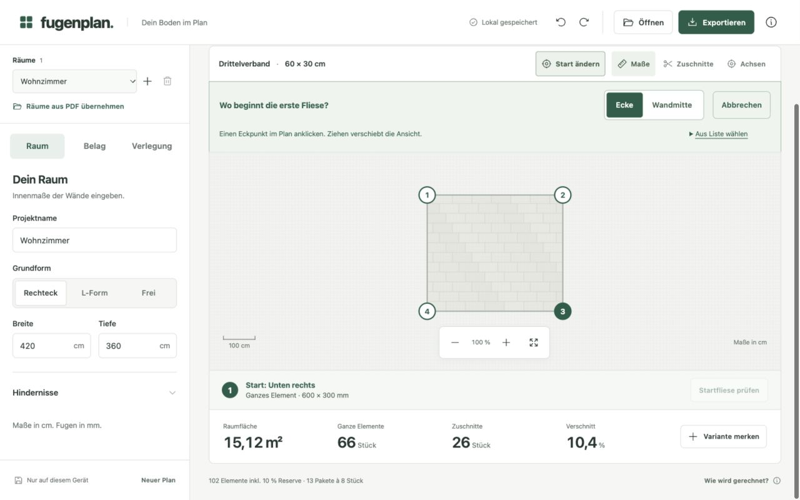
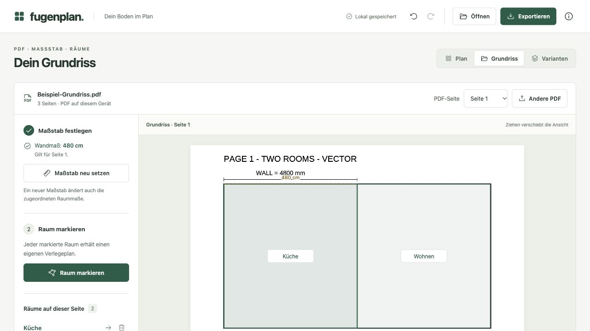

# Fugenplan

### Dein Boden im Plan. Bevor du die erste Fliese schneidest.

Passt eine ganze Fliese an die Tür? Wie schmal wird der Randstreifen? Was ändert sich, wenn du an einer anderen Wand beginnst?

**Fugenplan macht aus Raummaßen oder einem PDF-Grundriss einen sichtbaren Verlegeplan für Fliesen und Dielen.** Probiere Muster und Startpunkte aus. Prüfe Zuschnitte. Vergleiche Mengen und Verschnitt, bevor du Material bestellst.

**Ohne Konto. Ohne Backend. Deine Pläne bleiben in deinem Browser.**



[Schnell starten](#schnell-starten) · [PDF-Grundriss verwenden](#vom-grundriss-zum-verlegeplan) · [Bedienungsanleitung](docs/ANLEITUNG.md) · [Entwicklung](#entwicklung)

## Was du damit planen kannst

| Du möchtest … | Fugenplan hilft dir dabei |
| --- | --- |
| Deinen Raum abbilden | Rechteck, L-Form oder freie Eckpunkte; Hindernisse wie Säulen bleiben frei. |
| Einen vorhandenen Grundriss nutzen | PDF öffnen, eine bekannte Wand markieren, Länge eingeben und Räume nachzeichnen. |
| Die Wirkung des Belags vergleichen | Sieben Muster, eigene Produktmaße, Fugen, Randabstände, Drehung und Versatz. |
| Den richtigen Anfang finden | Eine Ecke oder Wandmitte direkt im Plan als Start wählen. |
| Randstücke vorab prüfen | Schnittkonturen, Kantenlängen und Hüllmaße einzelner Elemente ansehen. |
| Materialbedarf abschätzen | Ganze Elemente, Zuschnitte, Verschnitt, Reserve und gerundete Paketzahl sehen. |
| Varianten vergleichen | Bis zu zwölf Planstände merken; Änderungen rückgängig machen und wiederholen. |
| Den Plan mitnehmen | Projektdatei, maßstäbliches SVG, CSV-Elementliste und Druckausgabe als PDF. |

Zur Auswahl stehen Kreuzverband, Halbverband, Drittelverband, Viertelverband, Wilder Verband, Diagonalverband und Fischgrät. Die Oberfläche passt sich an Desktop und Smartphone an.

## Schnell starten

Du brauchst **Git und Node.js**. Empfohlen ist **Node.js 24** mit npm. Die unterstützten Node-Versionen stehen in `package.json`; `.nvmrc` wählt Version 24.

```sh
git clone https://github.com/dYn36/fugenplan.git
cd fugenplan
npm ci
npm start
```

Der Browser öffnet **http://127.0.0.1:5173**. Lass das Terminal während der Nutzung geöffnet. Mit `Strg+C` beendest du den Server.

- **Privates Repository:** Zum Klonen brauchst du Zugriff auf das Repository und eine eingerichtete GitHub-Anmeldung. Zugangsdaten gehören nicht in die Clone-URL oder in Projektdateien.
- **macOS:** Nach der Installation kannst du auch `Starten.command` doppelt anklicken.
- **Windows und Linux:** Nutze die Befehle oben im Terminal.
- **Mit nvm:** Führe vor `npm ci` einmal `nvm install` und `nvm use` aus.

Für Fugenplan sind **keine API-Schlüssel, keine `.env`-Datei und keine Datenbank** erforderlich. Die erste Installation lädt Pakete aus npm. Danach kann die lokal installierte Anwendung ohne Internetverbindung arbeiten. Schriften, Symbole und PDF-Decoder werden lokal bereitgestellt.

## Vom Grundriss zum Verlegeplan

1. **PDF öffnen.** Wähle deinen Grundriss und die gewünschte Seite.
2. **Maßstab setzen.** Markiere die Endpunkte einer bekannten Wand. Gib die tatsächliche Länge in Zentimetern ein, zum Beispiel `480` für 4,80 m.
3. **Raum bestimmen.** Markiere die inneren Raumecken der Reihe nach und vergib einen Namen.
4. **Belag ausprobieren.** Wähle Produktmaß, Fuge, Muster und Startposition. Prüfe die Randstücke im Plan.
5. **Projekt sichern.** Die Projektdatei enthält alle Räume, Maßstäbe und die Original-PDF.



Jede PDF-Seite hat einen eigenen Maßstab. Ein Projekt kann bis zu 50 Räume enthalten. Die Raumauswahl erfolgt manuell. Ein gleichmäßiger Maßstab in beiden Richtungen ist erforderlich; verzerrte Scans müssen vorher korrigiert werden.

## Daten unter deiner Kontrolle

Die Anwendung berechnet den Plan im Browser. Sie hat kein Benutzerkonto, keine Cloud-Synchronisierung und keine Analyse- oder Werbedienste. Räume und Varianten liegen im lokalen Browserspeicher; Original-PDFs liegen in IndexedDB.

**Sichere wichtige Stände als Projektdatei.** Ein anderer Browser oder eine andere Webadresse hat einen eigenen Speicher. Das Löschen von Browserdaten entfernt auch deine dort gespeicherten Pläne. Separat gemerkte Varianten sind nicht Teil der Projektdatei.

Die mitgelieferten Prüf-PDFs und die abgebildeten Räume sind synthetische Beispiele. Eigene Grundrisse und Projektdateien gehören außerhalb des Quellcode-Repositorys.

## Was die Mengen bedeuten

Jedes angeschnittene Element zählt als ein neues Ausgangsstück. Reststücke werden nicht automatisch für andere Stellen wiederverwendet. Der Materialbedarf ist deshalb eine Berechnung **ohne Reststückoptimierung**. Reserve und Paketrundung werden zusätzlich berücksichtigt.

Ein Hüllmaß ist bei schrägen Schnitten nicht die Mindestbreite eines Reststücks. Prüfe dafür die Schnittkontur. Zentrieren ist keine automatische Verschnittoptimierung. Produktvorgaben für Fugen, Versatz und Fischgrät bleiben maßgeblich.

Fugenplan ersetzt kein Aufmaß vor Ort. Einzelheiten zu Rechenregeln, Druckmaßstab, Eingabegrenzen und Speicherung stehen in der [Bedienungsanleitung](docs/ANLEITUNG.md).

## Entwicklung

```sh
npm run dev          # Entwicklungsserver
npm test             # Geometrie, Speicherung, Kalibrierung und Exporte
npm run build        # TypeScript-Prüfung und Produktionsbuild
npm run preview      # Produktionsbuild lokal ansehen
npm run check        # Tests und Produktionsbuild zusammen
```

Für die Browser-Tests wird Chromium benötigt:

```sh
npx playwright install chromium
npm run test:e2e
```

Unter Linux kann `npx playwright install --with-deps chromium` zusätzliche Systempakete installieren. Die Test-PDF lässt sich mit `node tests/fixtures/create-floorplan-fixture.mjs` neu erzeugen.

**Technik:** React, TypeScript, Vite, SVG und Web Worker. PDF.js verarbeitet Grundrisse; Clipper und polygon-clipping berechnen Konturen. Es gibt keinen Server für Projektdaten.

```text
src/components/  Oberfläche und Planansichten
src/lib/         Geometrie, PDF, Speicherung und Exporte
tests/           Automatische Tests und synthetische Prüfdaten
scripts/         Lokale PDF-Assets vorbereiten
docs/            Bedienung, Rechenregeln und Prüfnachweise
```

`npm ci` erzeugt `public/pdfjs/` aus der installierten PDF.js-Version. Dieser Ordner und `dist/` werden nicht eingecheckt. Die GitHub-Prüfung führt Installation, Tests und Build mit Node.js 24 aus.

## Selbst hosten

```sh
npm ci
npm run build
```

Stelle anschließend den Ordner **`dist/`** über einen statischen HTTP-Server bereit. Die Anwendung benötigt einen HTTP-Server für ihre Web Worker; öffne `index.html` nicht direkt als Datei. Auch bei gehostetem Betrieb bleiben Pläne im jeweiligen Browser. Ein Hosting-Dienst stellt nur die Anwendung bereit.

## Projektstatus und Lizenz

Fugenplan wird derzeit als **privates Projekt** geführt. Ob und unter welcher Lizenz der Code später öffentlich freigegeben wird, ist noch offen. Es ist noch keine Open-Source-Lizenz festgelegt.

`private: true` verhindert eine versehentliche Veröffentlichung des npm-Pakets. Es steuert nicht die Sichtbarkeit des GitHub-Repositorys. Abhängigkeiten behalten ihre jeweiligen Lizenzen.

## Weiterführend

- [Bedienungsanleitung](docs/ANLEITUNG.md)
- [Fachliche Grundlagen und Rechenregeln](docs/RECHERCHE.md)
- [PDF-Technik](docs/PDF-TECHNIK.md)
- [Prüfung der letzten Fehlerkorrekturen](docs/REVIEW-FIXES-PRUEFUNG.md)
- [Umgang mit Zugangsdaten und privaten Plänen](SECURITY.md)
