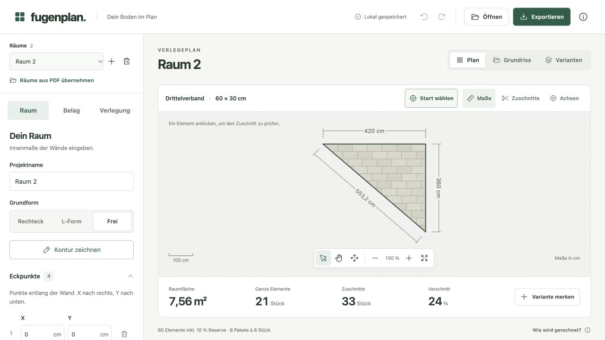

# Prüfung der Review-Korrekturen

Stand: 26.10.2026

## Kontur und Startposition

- Geometrie, Startprüfung und Raumänderungen verwenden dieselbe Anzahl wirksamer Eckpunkte.
- Werden der letzte und der erste Punkt gleich, wird eine bestehende Startbindung mit ihrem Versatz zurückgesetzt. Normale Maßänderungen erhalten eine gültige Bindung.
- Bereits betroffene Browser-Speicherstände werden geladen. Nur die nicht mehr vorhandene Startposition und ihr Versatz werden zurückgesetzt. Die Anwendung zeigt dazu einen Hinweis.
- Die Wiederherstellung erhält alle Räume, den aktiven Raum, Maße, Beläge, PDF-Metadaten und die Zuordnung zur PDF. Sie gilt auch für das frühere Einzelraumformat.
- Dateiimporte bleiben streng geprüft. Ungültige Datentypen, unbekannte Startarten und andere beschädigte Projektdaten werden nicht als gültig behandelt.

## Escape in Eingabefeldern

- Der globale Escape-Handler läuft nach den Feld-Handlern.
- Escape verwirft eine unbestätigte Zahl oder einen unbestätigten Namen. Die Startauswahl bleibt dabei geöffnet.
- Escape im Raumplan schließt die Startauswahl und setzt den Fokus auf die Schaltfläche zurück.
- Enter und Tab übernehmen Änderungen weiterhin.

## Nachweise

- Vor der Korrektur: Vier neue Regressionstests für das Laden betroffener Einzelräume und PDF-Projekte schlugen fehl.
- Nach der Korrektur: `npm test` bestand mit **165 Tests in vier Dateien**. Das sind 18 zusätzliche Tests.
- `npm run build` bestand einschließlich TypeScript-Prüfung. Die bereits vorhandene Vite-Warnung zu einem JavaScript-Bündel über 500 kB bleibt bestehen.
- Vier automatische Browser-Regressionsfälle wurden ergänzt. `npm run test:e2e -- --list` erkennt insgesamt 28 Browser-Tests. Die vollständige automatische E2E-Suite wurde in dieser Sitzung nicht ausgeführt.
- Die betroffenen Abläufe wurden in einer getrennten Browser-Testinstanz auf Port 5174 geprüft: Escape bei Zahlen und Namen, Fokus-Rückkehr, Enter, Tab, Rückgängig, Wiederholen sowie Schließen der Kontur mit einer gewählten vierten Ecke und einer gewählten vierten Wand.
- Nach erneutem Laden blieben beide Testräume erhalten. Der geänderte Raum wurde als Dreieck mit 7,56 m² und 54 Elementen berechnet. Auch das erneute Öffnen in einem neuen Tab erhielt diesen Stand.
- Die Speicher-Reparatur mit PDF-Zuordnung, ihr anschließender Export sowie die Ablehnung anderer beschädigter Daten sind durch die automatischen Tests abgedeckt.

