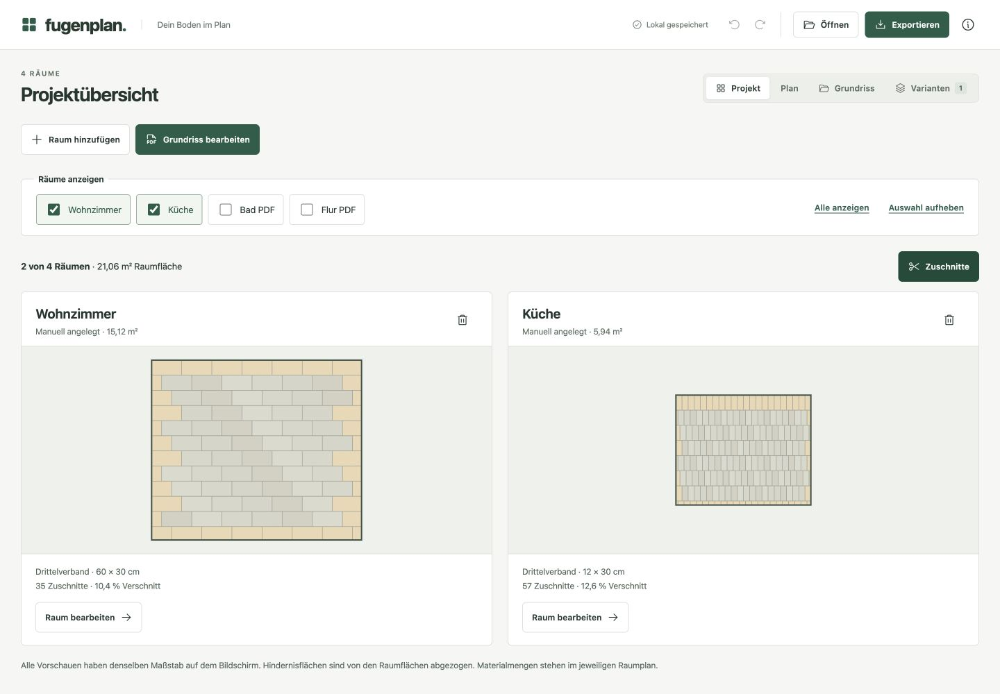

# Abnahme: Projektansicht und PDF-Assistent

Stand: 26. Oktober 2026. Die sieben beauftragten Punkte sind umgesetzt und geprüft. Der letzte Bereinigungsdurchgang ist abgeschlossen. Danach bestanden alle 167 Unit-Tests, alle 36 Browsertests und der Produktionsbuild.

## Ergebnis und Nachweise

| Auftrag | Ergebnis | Nachweis |
| --- | --- | --- |
| Mehrere Räume gleichzeitig anzeigen | Die Projektübersicht zeigt ausgewählte Verlegepläne mit gleichem Bildschirmmaßstab. Räume lassen sich direkt öffnen. Ein- und Ausblenden verändert keine Raumdaten. Die Einzelansicht hat eine sichtbare Raumliste. | [Projektansicht](../src/components/ProjectOverview.tsx), [Browsertests](../tests/project.e2e.spec.ts), Abschlussbilder unten |
| Eigenen Grundriss mit einem Assistenten übernehmen | Vier Schritte führen durch PDF/Seite, Wandmaß, Raumkontur und Prüfung. Weitere Räume lassen sich ohne Ausstieg erfassen. Rückwege erhalten den Entwurf; vor seinem Verwerfen folgt eine Entscheidung. | [PDF-Assistent](../src/components/FloorPlanEditor.tsx), [Ablaufprüfung](UX-ABLAEUFE.md) |
| Fliesenvorlage 12 × 30 cm ergänzen | Die zusätzliche Vorgabe setzt 120 × 300 mm. Andere Raumpläne behalten ihre eigenen Einstellungen. | [Belageinstellungen](../src/components/Controls.tsx), Mehrraum-Browsertest |
| UX-Audit durch einen Spezialisten | Der UX Researcher hat elf Befunde am Ausgangsstand dokumentiert. Der Bericht trennt Quellprüfung und vorhandene Bilder von späteren Laufzeittests. | [Ausgangsaudit](UX-AUDIT.md) |
| Alle Prozesse mit dem UX Architect durchgehen | Der Architect hat 25 Prozessgruppen im Browser durchlaufen. Dazu gehören Raumformen, Beläge, Muster, Startwahl, Varianten, Dateien, PDF-Seiten, Verlauf und mobile Bedienwege. | [Geprüfte Abläufe und elf Bilder](UX-ABLAEUFE.md) |
| UI Finish-Gate am Ende | Der Reviewer hat sechs Befunde geschlossen und die dokumentierten Desktop- und Mobilansichten mit **PASS** bewertet. | [Schlussprüfung mit Messwerten und Bildern](UI-FINISH-GATE.md) |
| Zuletzt Anti-KI-slop-Bereinigung | Der letzte Agent hat wiederholte Texte und ungenutzte CSS-Regeln entfernt. Flächenhinweis und Verwerfen-Dialog sind präziser. Aktionslabels und Funktionslogik blieben unverändert. | [Bereinigung und gezielte Nachprüfung](UX-BEREINIGUNG.md) |

Der [Gestaltungsvertrag](UX-DESIGN-VERTRAG.md) beschreibt die verbindlichen Bedien- und Darstellungsregeln. Die [Anleitung](ANLEITUNG.md) erklärt die neuen Abläufe. Das Demo-GIF bleibt direkt im Einstieg der [README](../README.md).

## Abschließende automatische Prüfung

Diese Läufe erfolgten nach der letzten Änderung am Anwendungscode:

| Befehl | Ergebnis |
| --- | --- |
| `npm run check` | 167 Unit-Tests in vier Dateien bestanden. TypeScript-Prüfung und Vite-Produktionsbuild erfolgreich. |
| `npm run test:e2e` | 36 von 36 Tests mit Chromium und zwei Workern bestanden. Laufzeit: 1,2 Minuten. |
| `git diff --check` | Keine fehlerhaften Leerzeichen oder Konfliktmarkierungen gemeldet. |

Die 36 Browsertests umfassen 21 bestehende Planfälle, sieben PDF-Fälle und acht neue Projekt-/Wizard-Fälle. Die neuen Fälle prüfen auch 50 kleine Räume, getrennte Raumdaten, die zusätzliche Fliesenvorgabe, Auswahl ohne Datenverlust, benannte Löschentscheidungen, zwei PDF-Räume in einem Ablauf sowie Abbruch und Bestätigung beim PDF-Ersatz.

Gezielte Regressionen sichern den Entwurfsschutz bei Rückgängig/Wiederholen, die Wiedererkennung des unveränderten Beispielraums nach dem Neuladen, den Fokus nach Schritt- und Dialogwechsel sowie die mobile Raumöffnung. Ein Zeigertest setzt bei 125 % PDF-Zoom vier Raumecken und prüft die berechneten 24,96 m². Die Werkzeugleiste liegt außerhalb der Zeichenfläche.

Die neuen Projekt-/Wizard-Scans prüfen alle von Axe gemeldeten Befunde der Tags `wcag2a`, `wcag2aa` und `wcag21aa`. Sie bestanden ohne Befund in den getesteten Zuständen. Die bestehenden Tests mit Filter auf schwere Befunde sind davon getrennt. Bei 390 und 320 px prüfen die neuen Mobilfälle außerdem horizontalen Überlauf und mindestens 44 × 44 px für die dort geprüften Kopf- und Planaktionen.

Vite meldet weiterhin einen Anwendungschunk über 500 kB nach Minifizierung. Der Build ist erfolgreich. Diese Größenwarnung ist keine Messung der Ladezeit.

## Abschlussbilder nach der Bereinigung

Die Bilder stammen aus dem eingebetteten Browser auf `http://localhost:5173/`. Das synthetische Testprojekt enthält vier Räume. Wohnzimmer und Küche sind eingeblendet; die beiden PDF-Räume sind ausgeblendet. Die Raumdaten bleiben erhalten. Wohnzimmer verwendet 60 × 30 cm, Küche 12 × 30 cm. Ihre gemeinsame Fläche beträgt 21,06 m².

[Mobile Projektübersicht bei 390 × 844 px](../screenshots/ux/abschluss-projekt-mobil.jpg). Auch mit vier Auswahlfeldern ist die erste Zeichnung vollständig im ersten Bildschirm sichtbar. Der temporäre Viewport wurde danach zurückgesetzt und der Prüftab geschlossen.

## Grenzen der Prüfung

Die manuellen Durchgänge decken die dokumentierten Prozessgruppen ab. Sie prüfen nicht jede Kombination aller Eingaben. Die mobile Prüfung verwendet schmale Browserfenster. Ein echtes iPhone, dessen Bildschirmtastatur, vergrößerte Betriebssystemschrift und ein manueller Screenreader-Durchgang wurden nicht geprüft.

SVG-/CSV-Inhalte, Druckmaßstab und A4-Sperre sind automatisch geprüft. Der eingebettete Browser zeigte beim manuellen Durchgang keine native Druckvorschau. Ein physischer Ausdruck ist nicht nachgewiesen. Aus diesen Prüfungen folgt keine Aussage über vollständige Barrierefreiheit oder physisch maßhaltigen Druck.
